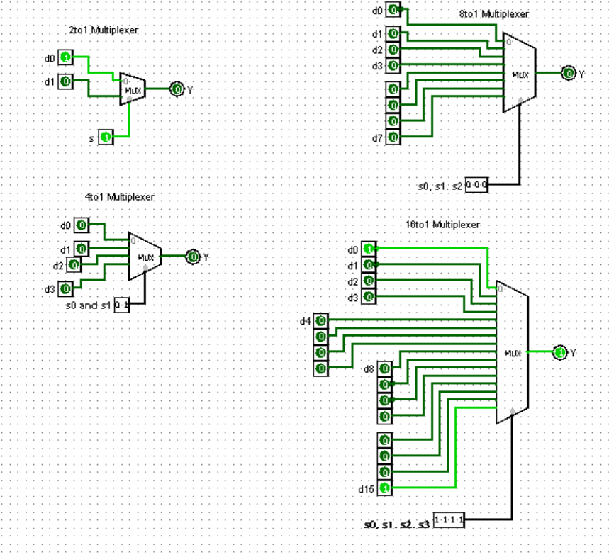
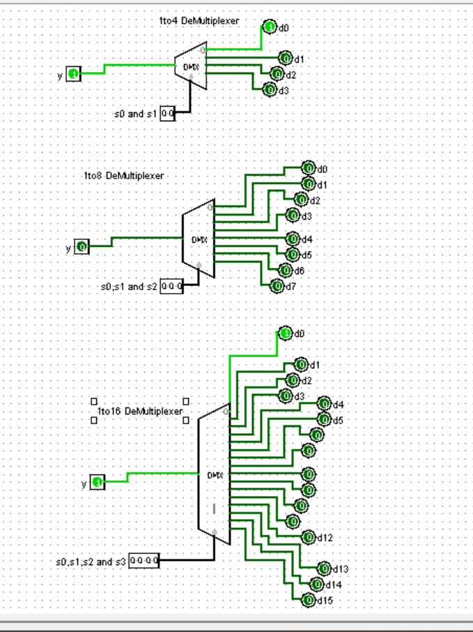

# ⚡ Multiplexer and Demultiplexer Circuits

> A collection of foundational digital logic circuits designed and simulated using **Logisim**. This repository contains hierarchical implementations of standard multiplexers (MUX) and demultiplexers (DEMUX), demonstrating data routing and selection logic.

---

## 🔌 Circuits Included

### 🔀 Multiplexers (Data Selectors)
These circuits route multiple input signals to a single output line based on binary select lines.

| Circuit Type | Data Inputs | Select Lines | Output |
| :--- | :---: | :---: | :---: |
| **2-to-1 MUX** | 2 (`d0`, `d1`) | 1 (`s`) | 1 |
| **4-to-1 MUX** | 4 (`d0`-`d3`) | 2 (`s0`, `s1`) | 1 |
| **8-to-1 MUX** | 8 (`d0`-`d7`) | 3 (`s0`-`s2`) | 1 |
| **16-to-1 MUX**| 16 (`d0`-`d15`) | 4 (`s0`-`s3`) | 1 |

### 🔂 Demultiplexers (Data Distributors)
These circuits route a single input signal to one of several output lines based on binary select lines.

| Circuit Type | Data Input | Select Lines | Outputs |
| :--- | :---: | :---: | :---: |
| **1-to-2 DEMUX** | 1 (`y`) | 1 (`s0`) | 2 (`d0`, `d1`) |
| **1-to-4 DEMUX** | 1 (`y`) | 2 (`s0`, `s1`) | 4 (`d0`-`d3`) |
| **1-to-8 DEMUX** | 1 (`y`) | 3 (`s0`-`s2`) | 8 (`d0`-`d7`) |
| **1-to-16 DEMUX**| 1 (`y`) | 4 (`s0`-`s3`) | 16 (`d0`-`d15`) |

---

## 🛠️ Software Used

* **Logisim:** The circuits were built and tested using Logisim. 
* **Format:** Project files are saved in the `.circ` format (Logisim's native XML-based circuit format).

---

## 📸 Previews

<b>Click to expand Multiplexer Schematics</b>

 

<b>Click to expand Demultiplexer Schematics</b>

 

---

## 🚀 How to Use

1. **Download:** Install [Logisim](http://www.cburch.com/logisim/) on your machine.
2. **Clone:** Clone or download this repository as a `.zip` file.
3. **Run:** Open Logisim, navigate to `File > Open`, and select the `.circ` project file.
4. **Interact:** Use the **Hand Tool** (✋) in Logisim to toggle the input and select lines and observe the output changes.
